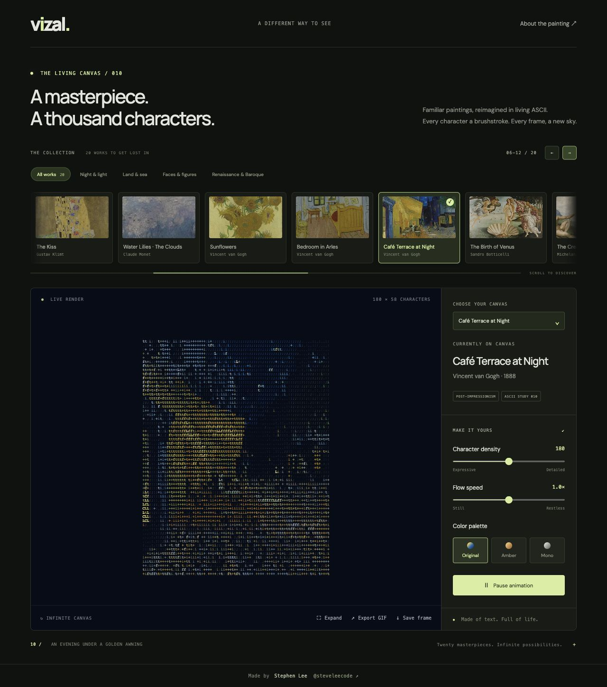

# Vizal

**Classic art. Living characters.** Built by [Stephen Lee](https://github.com/steveleecode).

A browser-based, animated ASCII art studio. The collection includes 20 selectable artworks. Starry Night is a procedural interpretation of Vincent van Gogh's **The Starry Night**, inspired by the supplied terminal-animation reference. All painting marks are ASCII glyphs drawn on a canvas. The 19 additional works use local Wikimedia source images, converted to animated ASCII in the browser. Source references are in `public/artworks/sources.json`. Portraits retain their original proportions. This is an approximation of the reference's visual style, not a pixel-exact reconstruction.



## Local development

Use Node.js 22.12 or newer (Node.js 22 LTS recommended for deployment).

```sh
git clone git@github.com:steveleecode/Vizal.git
cd Vizal
npm ci
npm run dev
```

Open the local URL printed by Vite. `npm run build` produces a deployable `dist/` folder; `npm run preview` previews that build.

## Controls

- Density: 100–260 columns, with proportional row counts.
- Flow: 0–2× animation speed.
- Original, amber, or monochrome colors.
- Pause/resume (also Space when a control is not focused).
- Expand: fullscreen artwork.
- Save frame: PNG at the renderer's native resolution.

Reduced-motion preferences start the artwork paused. All rendering happens locally in the browser. Fonts use Google Fonts with system fallbacks.

## Add an artwork

`src/artworks.js` exports an `artworks` registry. Each artwork supplies metadata and a pure `sample(x, y, time, column, row)` function returning `{ glyph, color: [r, g, b] }`. Coordinates are normalized to 0–1 and time is in seconds. Register a sampler, or add an image artwork with its metadata and a local asset. Collection cards, the dropdown, and title metadata update from the registry automatically. The renderer, palette controls, and exports are independent of the artwork sampler.

`src/main.js` owns the canvas and animation loop; `src/style.css` owns the responsive studio interface. Rendering targets 30 fps, decodes image assets once, coalesces density changes, and skips hidden-tab rendering. Artwork switches crossfade and respect reduced-motion preferences. Exports support still PNGs and animated GIFs; MP4 export and arbitrary image uploads are future extensions.

## Animated GIF export

Choose **Export GIF** to open the size picker. Small (320×194), Medium (640×388), Large (960×582), and custom dimensions (64–1600 px per side) each get an actual encoded GIF preview with its exact file size. Pick 3 or 6 seconds, then select a preview and download. Artwork is fitted inside the requested dimensions without stretching. Current palette, density, and speed are captured when the popup opens; pause does not disable export animation, while speed zero produces a still loop.

Encoding uses the MIT-licensed [gifenc](https://github.com/mattdesl/gifenc) library in a dedicated Web Worker; no API, payment, or image upload is required. Previews use 128 colors and 12 frames per second. Motion eases forward and back for a continuous replay. Closing the popup cancels generation and releases preview URLs. A modern browser with OffscreenCanvas and createImageBitmap support is required.

## Collection browsing

Twenty works span Renaissance, Baroque, Romanticism, Impressionism, and more. The fixed-height gallery supports smooth previous/next navigation, touch and trackpad scrolling, category filters, a visible-range counter, and a position indicator. Within the gallery, Left/Right and Home/End move keyboard focus; Enter selects. Dropdown selections reveal the matching gallery card, returning to All works when needed. Reduced-motion preferences disable animated navigation. Small local WebP thumbnails load lazily, and the decoded artwork cache retains up to six entries.


## Deploy to Vercel

This is a static Vite site. No backend, database, API keys, or environment variables are required.

1. In Vercel, choose **Add New → Project** and import `steveleecode/Vizal` from GitHub.
2. Keep the root directory at the repository root and use **Vite** as the framework preset.
3. Set the Node.js version to **22.x**. Use `npm ci` for installation, `npm run build` for the build command, and `dist` for the output directory.
4. Deploy. Set `main` as the production branch; subsequent pushes to it trigger production deployments when the Git integration is enabled.

`vercel.json` records the framework, build command, and output directory. Vercel serves artwork, thumbnails, the favicon, and the bundled GIF worker with the built site. There are no client-side routes requiring rewrite rules.

Before deployment, validate locally:

```sh
npm ci
npm run build
npm run preview
```

The GitHub Actions workflow also installs dependencies and builds on pushes to `main` and on pull requests. There is currently no automated browser test suite. Browser checks performed during development covered painting selection, gallery filters/navigation, responsive layouts, and preset/custom GIF downloads.

## Project structure

| Path | Purpose |
| --- | --- |
| `index.html` | Studio markup, metadata, favicon, and attribution |
| `src/main.js` | App state, artwork selection, animation loop, and PNG export |
| `src/artworks.js` | Artwork registry, image sampling, palettes, and decode cache |
| `src/renderer.js` | Shared ASCII canvas renderer |
| `src/collection.js` | Sliding gallery, filtering, and keyboard navigation |
| `src/gif-export.js` | GIF size picker, animated previews, and download lifecycle |
| `src/gif.worker.js` | GIF palette generation and encoding off the main thread |
| `src/style.css` | Responsive styles and reduced-motion behavior |
| `public/artworks/` | Local source images, WebP thumbnails, and source references |
| `public/favicon.png` | Supplied Vizal logo |
| `vercel.json` | Static deployment configuration |

When adding a painting, include a matching `public/artworks/thumbnails/<id>.webp`, update the source references, assign any category memberships in `src/collection.js`, and update the collection counts/copy in `index.html`. The registry drives the cards, dropdown, and current-artwork metadata.

## Browser support and limitations

Use a current Chrome, Edge, Firefox, or Safari. GIF export needs Web Workers, OffscreenCanvas, and createImageBitmap. Larger custom exports take longer and use more memory; dimensions are limited to 1600 pixels per side. GIFs use a 128-color palette, so colors can differ slightly from the live canvas. Animated previews are sized to fit their cards; the pixel labels show actual export dimensions.

The site processes images and exports locally. Google Fonts is the only external runtime asset request; system fonts provide a fallback. Artwork links open external source pages. The included works animate with subtle procedural effects rather than AI-generated motion.

## Artwork sources and credits

The collection uses historical artworks reproduced from Wikimedia-hosted files. Per-artwork reference pages and exact download URLs are preserved in [`public/artworks/sources.json`](public/artworks/sources.json). Follow those references for authorship and reproduction details before repurposing assets. GIF encoding uses [gifenc](https://github.com/mattdesl/gifenc), licensed under MIT. The Vizal logo was supplied by Stephen Lee.

No license for the original Vizal application code has been selected; dependency and artwork notices do not grant a separate license to the application.
